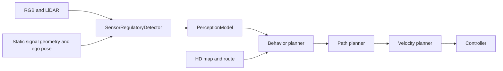

# Architecture and behavior

## Data flow

`SensorRegulatoryDetector` performs image inference and geometric association.
It publishes `RegulatoryObservation`; the behavior planner consumes observations
without importing the classifier. `SensorTelemetryTask` records the result.
`CarlaRegulatoryTask` is a separate ground-truth source for comparison scenarios,
not a fallback when camera inference fails.

## Road planning

`HDMapLaneFollowingPlanner` follows connected lanes. `regulatory.py` extracts
OpenDRIVE controls, lane applicability and crossing geometry.
`HDMapBehaviorPlanner` handles STOP approach and continuous stopped dwell,
traffic-light waiting, occupied-crosswalk yielding and reduced crossing speed.
`HDMapStopBehaviorPlanner` is a compatibility alias.

`ReferencePathPlanner` follows the selected route. `HDMapRuleVelocityPlanner`
applies stopping, obstacle and curvature constraints to a copy of the trajectory,
so a stop does not permanently zero subsequent reference speeds. Unknown or stale
observations cause conservative waiting. Timing uses simulation seconds.

## Race planning

`RaceBehaviorPlanner` requests following or passing a slower rival.
`RacePathPlanner` checks proposed lattice paths against predicted collisions and
oriented vehicle clearance. It can hold a passing corridor and use a checked
return path; an unavailable safe path results in following or braking.
`RaceVelocityPlanner` applies the behavior speed limits and obstacle/curvature
envelope. This is experimental low-speed racing behavior.

`RaceTrafficTask` creates scripted rivals in BasicSim and cleans up its own
actors. It does not create CARLA traffic. See the
[validation report](../VALIDATION.md) for the tested scenarios.

## Replacing planners

The dispatchers select road or race algorithms by concrete map type. Unknown
maps are rejected; they are not treated as race tracks. Mixed road/track
transitions inside one map are not implemented.

`PlannerSwitchTask` accepts `SelectPlanningStack(global_plan, expected_map)`
through the executor task runner. It validates the candidate route, first local
plan and capability requirements before publishing the pair. Successful
replacement resets controller integrators and the held control command.
Moving vehicles, stale requests and failed validation retain the current pair.
This protocol supports `SyncExecuter`; threaded replacement needs separate
synchronization. It replaces planning, not perception or the simulated world.

## Perception boundaries

The standalone `avlite_signal_perception` package needs no AVLite or CARLA
imports. It classifies image crops and combines associated heads. The AVLite
adapter owns frame freshness, projection, green confirmation and pedestrian
fusion. See [the package guide](../SIGNAL_PACKAGE.md) and
[adapter reference](../SENSOR_PERCEPTION.md).
