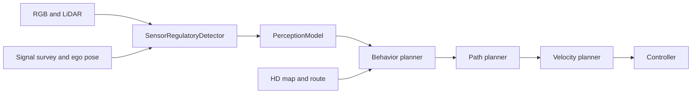

# Architecture

The plugin adds strategies to AVLite's existing perception, planning, control
and task interfaces.

## Road planning

`perception/regulatory.py` extracts OpenDRIVE controls, lane applicability and crossing
geometry. `HDMapLaneFollowingPlanner` follows connected lanes, excluding lateral
lane-change edges.

`HDMapBehaviorPlanner` handles STOP approach and dwell, traffic-light waiting,
crosswalk yielding and reduced crossing speed. `HDMapBehaviorTreePlanner`
composes the same rule actions as a reactive tree. `HDMapStopBehaviorPlanner`
is retained as a compatibility alias.

`ReferencePathPlanner` follows the route. `HDMapRuleVelocityPlanner` applies
stopping, obstacle, curvature and configured speed limits to a copy of its
velocity profile. Unknown or stale observations cause waiting. Dwell and
freshness checks use simulation seconds.

## Race planning

`RaceBehaviorPlanner` requests following or passing a slower rival.
`RacePathPlanner` checks lattice proposals against predicted collisions and
oriented vehicle clearance. It holds a passing corridor and checks the return
path; if no feasible path is available, the vehicle follows or brakes.
`RaceVelocityPlanner` applies the behavior and obstacle speed limits.

`RaceTrafficTask` creates two scripted rivals in BasicSim and removes its own
actors on reset. It does not spawn CARLA traffic. The tested scenarios use
low-speed scripted traffic; see [validation](validation/road-and-race.md).

## Planner selection

`PlanningCoordinatorTask` selects registered configurations at startup or on an
explicit request. `PlannerSwitchTask` builds the candidate planners and checks
the route, capabilities and first local plan before replacing the active pair.
It resets controller integrators and clears the held command after acceptance.
Moving vehicles and stale or invalid requests retain the current pair.

Use `PlanningSyncExecuter` on stock AVLite 0.6.7. The local development core also
supports ordinary `SyncExecuter` and `AsyncThreadedExecuter`; threaded replacement
requires all workers to have exited. See [executor compatibility](executor-compatibility.md)
for the supported boundaries and [task coordination](task-coordination.md) for events.

## Perception

`SensorRegulatoryDetector` runs image inference and geometric association, then
publishes an immutable `EnvironmentObservation` and a legacy
`RegulatoryObservation` for existing telemetry. Behavior consumes the shared
snapshot without calling the classifier. Signal and crossing capabilities are
checked against the route. See [environment observations](environment-observations.md)
for alternate providers and the proposed core contract.

`CarlaRegulatoryTask` supplies ground-truth observations for comparison
scenarios. Do not enable it in sensor profiles. Detector failures remain unknown
and cannot switch to ground-truth observations.

The independent `avlite_signal_perception` package classifies RGB crops and
combines associated heads. The AVLite adapter handles projection, frame age,
green confirmation and pedestrian fusion. See [classifier setup](perception/classifier.md)
and [detector reference](perception/sensors.md).

## Replacing perception

`PerceptionSwitchTask` accepts `SelectPerceptionStack(perception, expected_map)`.
Construct a fresh `PerceptionStrategy` against `executer.pm`, add the switch task
to the runner, then submit the event through `executer.task_runner.notify(...)`.
Execution tasks must be enabled and the executor paused with the vehicle stopped.

The task checks the map, perception model and capability requirements before
replacement. It then clears previous object lists and regulatory/parking
observations. The executor's public `refresh_pipeline()` requests fresh perception
and planning before the next enabled control stage. Keep those stages enabled
when resuming. Construct models and configure sensors before submitting the
handover request.
